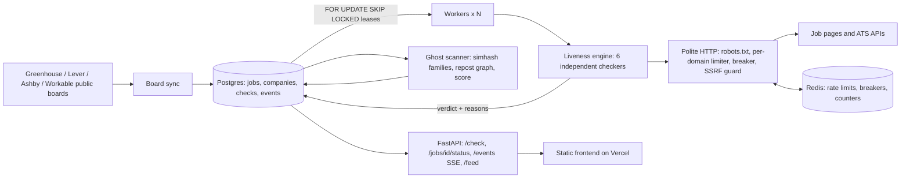

# Lively 🌻

Is this job still real and open? Lively answers that for any job link, keeps the answer fresh across tens of thousands of jobs without checking them all daily, and flags dead, reposted and ghost listings with plain-language reasons.

## In short

- **What I built:** a service that tracks 12,000+ jobs from 66 company job boards (Greenhouse, Lever, Ashby) and tells you whether each one is still open.
- **How it works:** workers check each job page and its job-board API, then combine the results into a live, closed or uncertain verdict with plain-language reasons.
- **Fewer checks:** jobs that stay unchanged are checked less and less often, cutting daily checks by about 79% compared with checking every job once a day.
- **Ghost and repost detection:** listings get a ghost score from age, how often they've been relisted, and evergreen wording.
- **Evals:** 100 hand-labeled jobs (live, closed, ghost, repost), with open/closed labels cross-checked against the ATS APIs, are compared with the system's predictions by `lively.ghost eval`.
- **Results:** closed detection is perfect (1.00 precision and recall). Telling ghosts from reposts is still weak and is the next thing to improve.

## Why

A matcher that sends "a few great jobs" cannot afford to send one that closed two weeks ago, was relisted under three IDs, or never had a real hire behind it. Lively sits between the job pile and the user and says whether each job is trustworthy right now.

## Architecture

## What is in it

- **Liveness engine.** Six independent checkers (HTTP and redirects, soft-404 phrases, board listing, ATS API, apply button, `validThrough`) combined as log-odds evidence into live, closed or uncertain, with a confidence and reasons. Login walls, 429s and partial loads come back as `uncertain`, never as a guess.
- **Adaptive scheduler.** Each job's re-check interval doubles while it stays unchanged and halves when it changes. Boards are re-synced on their own schedule, so one request marks every vanished job `suspect`.
- **Crash safety.** Postgres leases with heartbeats. A killed worker's jobs are reclaimed, stale results are discarded, and a unique index guarantees one recorded result per lease.
- **Politeness.** A Redis token bucket per domain, robots.txt, jittered backoff, a circuit breaker per domain, and a guard that refuses non-public addresses.
- **Ghost and repost detection.** Content fingerprints plus simhash group listings into role families. A repost graph and age feed a ghost score with reasons such as "reposted 4 times in 90 days".

## Benchmarks

From `lively.cli metrics` and `lively.ghost eval`.

| Metric | Value |
|---|---|
| Jobs tracked | 12,205 |
| Company boards | 66 |
| Checks per minute (3 workers) | ~270 (best sustained 10-min window) |
| Re-checks saved vs naive daily (projected, steady state) | 79.4% (2,425/day vs 11,776/day) |
| Jobs reclaimed after a killed worker, duplicates recorded | 480, 0 |

| Accuracy on 100 hand-labeled jobs | Precision | Recall |
|---|---|---|
| Bad-job filter (closed or ghost) | 0.54 | 0.90 |
| closed | 1.00 | 1.00 |
| ghost | 0.00 | 0.00 |
| repost | 0.07 | 0.04 |

Closed labels were cross-checked against the same ATS APIs the system uses, so closed precision is optimistic.

The labeled set is stratified on purpose, so these are sample numbers, not population rates. Live/closed labels were cross-checked against the ATS APIs; ghost vs repost is a judgment call where the scorer and the labels still disagree (most hand-labeled reposts score as ghosts), which is the next thing to tune. Labels live in `collector/seeds/labels.csv`.

## Run it

    docker compose up -d --build --scale worker=3
    docker compose run --rm bootstrap            # first run only: seed, discover, initial sync
    docker compose exec collector python -m lively.ghost scan
    open http://localhost:8000

`up` runs a one-shot `migrate` service first; the worker, API, metrics and ghost services start only after it exits successfully. Migrations are tracked in `schema_migrations` and are safe to re-run.

`bootstrap` is opt-in (it is not started by `up`). It records completion in `app_state` and does nothing on later runs. On a database that already has companies it only records that, without seeding or syncing. `--force` re-runs the steps, which only add rows. The individual `seed`, `discover` and `sync` commands still work as before.

## Known limits

- Only public ATS boards are covered. Companies with their own careers site are not.
- Soft-404 detection is phrase-based and English-only.
- Ashby and Workable have no single-job API check, so they lean on board listing.
- `board_listing` re-fetches whole boards, which will not scale to thousands of boards.
- Repost matching is per company. The same role on two boards is not merged.
- Ghost scoring weights are hand-tuned against 100 labels, not learned.
- The free hosting tier sleeps when idle.

## What I would build next at Elip

1. Derive board-listing signals from sync data instead of refetching boards.
2. Cross-source dedup with MinHash and LSH, so one role on five boards is one record.
3. A learned ghost model trained on the labeled set, with the current score as a feature.
4. Push the `job.closed` stream into the matcher so closed jobs are pulled from queued emails before they send.
5. Per-ATS closed-page fixtures and a regression suite for the soft-404 rules.

- https://job-boards.greenhouse.io/vercel/jobs/6188898004
- https://amazon.jobs/en/jobs/10612415/software-development-engineer-intern-2027-beijing
- https://www.micro1.ai/experts/opportunities

