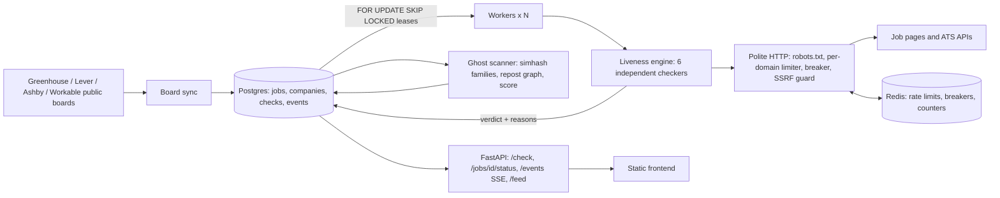

# Lively 🌻

**Job-listing liveness, freshness, and ghost/repost monitoring.**

Lively continuously monitors public job listings and answers a question that a plain availability check cannot: *is this job still genuinely open and actionable, or is it stale, closed, duplicated, or a ghost listing?*

---

## 1. What Lively does and who it helps

A job page returning HTTP 200 only proves that a server answered. It does not prove the role is still accepting applications. Lively combines several independent signals (HTTP behaviour, ATS data, company-board presence, page content, application controls and structured expiry metadata) into a verdict of `live`, `closed` or `uncertain`, with a confidence score and the reasons behind it.

It is built for job platforms, recruiting teams and job seekers who need to know whether a listing is still worth acting on.

- **Checks liveness.** Multiple signals are combined instead of trusting one page load.
- **Keeps data fresh.** Re-check frequency adapts to how stable or uncertain each listing is.
- **Explains decisions.** Every verdict stores the signals and plain-language reasons behind it.
- **Finds suspicious listings.** Similar jobs are grouped to spot evergreen, stale and repeatedly reposted roles.
- **Is observable.** Job counts, worker activity, queue state, checks and evaluation results are exposed through an API and dashboard.

The system has tracked about 12,000+ listings across 66 company boards. Counts depend on runtime, so read them from the dashboard.

---

## 2. Problem statement

A job matcher that promises "a few great jobs" cannot afford to send one that closed two weeks ago, was relisted under three IDs, or never had a real hire behind it. One dead job in an email costs more trust than ten good ones earn.

Three problems make this hard:

1. **A reachable page is not an open job.** Many closed jobs still return `200 OK` with "this position has been filled" in the body.
2. **Freshness does not scale naively.** Re-checking every job daily wastes requests on stable listings and still leaves fast-changing ones stale.
3. **Open does not mean real.** A listing can be live but evergreen, years old, or relisted again and again.

Lively treats liveness as an evidence-aggregation problem with an explicit `uncertain` state, and treats ghost/repost analysis as a separate heuristic assessment.

---

## 3. Demo and example checks

Runs locally via Docker Compose. Deployment is the next step, so there is no live URL yet.

Example job links to paste into the check box:

- https://job-boards.greenhouse.io/vercel/jobs/6188898004
- https://amazon.jobs/en/jobs/10612415/software-development-engineer-intern-2027-beijing
- https://www.micro1.ai/experts/opportunities


---

## 4. Architecture



The pipeline works as follows:

1. Discover and synchronise public company job boards.
2. Store job records and lifecycle state in PostgreSQL.
3. Workers claim due jobs through leases.
4. Pages and provider data are fetched through the shared polite HTTP client.
5. Independent liveness checkers run and their evidence is aggregated.
6. Check results and status transitions are persisted.
7. A separate scanner analyses similarity, reposts and ghost signals.
8. The API and dashboard expose operational and evaluation information.

PostgreSQL holds job state, check history, leases and schedules. Redis holds shared rate limits, circuit breakers, the robots cache and counters. Docker Compose runs the local stack.

---

## 5. Run locally

**Prerequisites:** Docker and Docker Compose, Git, a copy of the repository, and a `.env` file with the variables the Compose services expect.

Start the stack:

```bash
docker compose up -d --build --scale worker=3
```

The migration service runs first. The worker, API, metrics and ghost services start after it succeeds.

First-time bootstrap (opt-in, not run by `up`):

```bash
docker compose run --rm bootstrap
```

Bootstrap records completion in `app_state`. On later runs it does not repeat the initial seed, discover and sync unless forced. On a database that already has companies, it records that state instead of reseeding.

Run a ghost scan and open the dashboard:

```bash
docker compose exec collector python -m lively.ghost scan
open http://localhost:8000
```

Inspect the CLIs:

```bash
docker compose exec collector python -m lively.cli --help
docker compose exec collector python -m lively.ghost --help
```

Starting Compose keeps the services and workers running. The scheduler is application logic driven by persisted due times, and Docker is only the runtime.

---

## 6. How I built it: five stages

### Stage 1: Data collection and job lifecycle

- Public job-board data from Greenhouse, Lever, Ashby and Workable.
- Company boards discovered by probing slug variants, then synchronised.
- PostgreSQL tables for companies, jobs, check history, status events and labels.
- Lifecycle states `new`, `live`, `suspect`, `closed` and `reposted`.
- Source identifiers and URLs kept so records can be revisited and compared over time.

The key choice was to persist each listing's history and state instead of treating every crawl as a disposable snapshot.

**Lifecycle rules**

| From | Event | To |
|---|---|---|
| any | first seen on a board | `new` |
| `new`, `live`, `reposted` | vanishes from its company board | `suspect` |
| `suspect`, `closed` | reappears on the board | `live` |
| any open state | combined verdict `closed` with confidence 0.75 or higher | `closed` |
| any open state | combined verdict `closed` with confidence below 0.75 | `suspect` |
| `new`, `suspect`, `closed` | combined verdict `live` | `live` |
| any | `uncertain` verdict | unchanged |
| `new`, `live` | scanner finds an earlier listing of the same role | `reposted` |

A job leaves the board first as `suspect` and only becomes `closed` once the checkers confirm it.

### Stage 2: Multi-signal liveness engine

Six independent checkers each emit a signal: a direction (`live`, `closed` or `uncertain`) and a base confidence $c_i$.

| Checker | What it looks at | Base confidence $c_i$ |
|---|---|---|
| `ats_api` | ATS single-job endpoint (Greenhouse, Lever) | 404 → closed 0.97 · 200 → live 0.95 |
| `http_status` | status code, redirects, login walls | 410 → closed 0.98 · 404 → closed 0.95 · redirected away → closed 0.80 · plain 200 → live 0.50 |
| `board_listing` | is the job ID on the company's current board | listed → live 0.90 · absent → closed 0.90 · board empty → closed 0.60 |
| `soft404` | "no longer available" phrases, title present on page | phrase at top → closed 0.90 · phrase in body → closed 0.30 · title found → live 0.55 · title missing → closed 0.30 |
| `apply_button` | apply link, button or form | present → live 0.65 · absent on a full page → closed 0.35 |
| `valid_through` | `validThrough` in JobPosting JSON-LD | past → closed 0.90 · future → live 0.70 |

Login walls, 429, 403, 5xx, timeouts and partial loads return `uncertain` with confidence 0. They are never treated as proof either way. A checker that does not apply returns nothing, and a checker that crashes becomes an `uncertain` signal instead of failing the job.

The fetch layer uses async HTTP with a 600 KB body cap, a 25 s total timeout, redirect limits, and one memoised page fetch per job shared by all checkers.

#### How confidence is calculated

**Step 1: signal strength.** Each signal is scaled by a manually configured checker reliability weight $w_i$ and capped:

$$s_i = \min\bigl(0.97,\ \max(0,\ c_i)\cdot w_i\bigr)$$

| Checker | Weight $w_i$ |
|---|---|
| `ats_api` | 0.95 |
| `http_status` | 0.90 |
| `valid_through` | 0.90 |
| `board_listing` | 0.85 |
| `soft404` | 0.80 |
| `apply_button` | 0.50 |

**Step 2: evidence weight.** Each conclusive signal becomes additive evidence:

$$e_i = -\ln(1 - s_i)$$

A signal of strength 0.45 contributes 0.60. A signal of strength 0.90 contributes 2.30, so strong evidence grows quickly.

**Step 3: net evidence.** Let $L$ be the conclusive `live` signals and $C$ the conclusive `closed` signals. `uncertain` signals contribute nothing.

$$N = \sum_{i \in L} e_i \;-\; \sum_{j \in C} e_j$$

**Step 4: convert to scores.**

$$P_{live} = \frac{1}{1 + e^{-N}} \qquad P_{closed} = 1 - P_{live}$$

**Step 5: decide.** Closed is tested first:

$$
\text{verdict} =
\begin{cases}
\text{uncertain, confidence } 0 & \text{if there is no conclusive signal}\\
\text{closed, confidence } P_{closed} & \text{if } P_{closed} \ge 0.60\\
\text{live, confidence } P_{live} & \text{if } P_{live} \ge 0.66\\
\text{uncertain, confidence } \max(P_{live}, P_{closed}) & \text{otherwise}
\end{cases}
$$

A bare `200 OK` alone gives $N = 0.60$ and $P_{live} = 0.65$, which is below 0.66, so it stays `uncertain`. A page that loads proves little.

**Step 6: state change.** A `closed` verdict only moves a job to `closed` when confidence is at least 0.75. Between 0.60 and 0.75 the job becomes `suspect` and is re-checked sooner. This is what stops a single weak "removed from board" signal from killing a live job.

**Worked examples**

| # | Signals (verdict, $c$) | Evidence $e$ | $N$ | Result |
|---|---|---|---|---|
| 1 | ATS 200 live .95 · on board live .90 · page 200 live .50 | 2.33 + 1.45 + 0.60 | +4.37 | **live, 0.99** |
| 2 | ATS 404 closed .97 · page 404 closed .95 · off board closed .90 | 2.55 + 1.93 + 1.45 | −5.92 | **closed, 1.00** |
| 3 | off board closed .90 · page 200 live .50 | −1.45 + 0.60 | −0.85 | $P_{closed}$ = 0.70, so state becomes **suspect** |
| 4 | page 200 live .50 · apply button live .65 (custom careers URL, no ATS data) | 0.60 + 0.39 | +0.99 | **live, 0.73** |

**Interpretation caveat.** Despite the probability-like notation, these are heuristic confidence scores. The weights and thresholds are hand-set, not learned from a representative labelled dataset, and the scores have not been statistically calibrated. The aggregation also treats signals as independent, which they are not, since the board listing and the ATS API often move together. Treat 0.73 as "moderate evidence", not "73% chance the job is open".

### Stage 3: Adaptive scheduling and worker reliability

Checking every job at the same frequency wastes requests on stable listings and can leave changing ones stale. Lively persists each job's next due time and check interval.

#### Per-job interval

A check counts as a **change** if the content hash changed, the verdict flipped between live and closed, or the state moved. Let $I$ be the current interval:

$$
I_{next} =
\begin{cases}
\min\bigl(I_{cap},\ \max(I_{min},\ 2I)\bigr) & \text{if stable}\\[2pt]
\min\bigl(I_{cap},\ \max(I_{min},\ I/2)\bigr) & \text{if changed}
\end{cases}
$$

State overrides:

| State or verdict | Interval |
|---|---|
| `closed` | 7 days |
| `suspect` | $\min(24\text{h},\ 2\text{h} \cdot 2^{\min(k,3)})$ where $k$ is the unchanged streak |
| `uncertain` verdict | 1 hour |
| `live`, `new`, `reposted` | adaptive rule above, starting at $I_0$ (`BASE_INTERVAL`) |

Here $I_{min}$ is 30 minutes and $I_{max}$ is 7 days. Busy companies get a lower cap, based on $r$, the company's change rate:

$$I_{cap} = \min\Bigl(7\text{d},\ \max\Bigl(6\text{h},\ \frac{7\text{d}}{1 + 20r}\Bigr)\Bigr)$$

The actual delay is jittered by ±10% so requests to a host do not synchronise:

$$\text{delay} = I_{next} \cdot U(0.9,\ 1.1)$$

#### Per-company sync interval

Each board is re-synced on its own schedule. One board request marks every vanished job at that company `suspect` at once. The change rate $r$ is an exponentially weighted average of board churn:

$$r_{new} = 0.7\, r_{old} + 0.3 \cdot \min\Bigl(1,\ \frac{\text{inserted} + \text{suspect} + \text{reappeared}}{\max(\text{job\_count},\ 10)}\Bigr)$$

$$
I_{sync} =
\begin{cases}
\min\bigl(7\text{d},\ 1\text{h} \cdot 2^{\min(f, 8)}\bigr) & \text{if the last } f \text{ syncs failed}\\[2pt]
\text{clip}\Bigl(\dfrac{24\text{h}}{1 + 30r},\ 1\text{h},\ 24\text{h}\Bigr) & \text{otherwise}
\end{cases}
$$

#### Savings versus a naive daily check

With $N$ active jobs and current intervals $I_j$ in seconds:

$$\text{adaptive checks/day} = \sum_{j} \frac{86400}{I_j} \qquad \text{naive checks/day} = N$$

$$\text{saved} = \Bigl(1 - \frac{\text{adaptive}}{\text{naive}}\Bigr) \times 100\%$$

This is a projection from the *current* intervals. Right after a scheduler reset every job starts at $I_0$ and only backs off as it stays unchanged, so the number is **negative during ramp-up** if $I_0$ is below 24 hours. In an earlier steady-state run it reached **79.4%** (2,425 vs 11,776 checks per day). The latest post-reset snapshot read −41.6% while intervals were still ramping. Board sync is the fast path for catching closures, so per-job checks can start slow without delaying detection.

#### Claiming work and lease management

Workers claim due jobs with `FOR UPDATE SKIP LOCKED`, ordered suspect first, then new, then everything else, earliest due time first.

- A claim sets `lease_owner` and `lease_until = now() + L` ($L$ = 90 s by default).
- A heartbeat renews the lease every $L/3$ seconds while work is in flight.
- If a worker dies, the lease expires and another worker reclaims the job.
- Completing a job locks the row with `lease_owner = token` and writes checks, state and the event in one transaction. A stalled worker that wakes up late finds its token gone and discards its result.
- A unique index on `(job_id, lease_token)` for combined results guarantees at most one recorded result per lease.

Checking is at-least-once and recording is exactly-once. On SIGTERM a worker stops claiming, releases queued work and finishes in-flight checks.

These intervals are scheduling defaults, not guarantees of exact wall-clock timing. Worker availability, retries and host politeness all affect when a check actually runs.

### Stage 4: Ghost and repost analysis

Liveness asks whether a listing is open. Ghost analysis asks whether its history looks untrustworthy. These are kept separate: a job can be live and still a ghost, or closed without ever being one.

#### Grouping listings into role families

Within one company, two listings belong to the same family if either holds:

- their content fingerprints are identical, or
- their normalised title and location match and their SimHash Hamming distance is small:

$$d(a, b) = \operatorname{popcount}(a \oplus b) \le 10$$

SimHash is computed from the description's 3-word shingles, each hashed to 64 bits. Each bit of the fingerprint is the sign of the summed ±1 votes across shingles. Families are formed with union-find.

#### Repost rule

A listing is a **repost** if an earlier listing in its family either ended (closed, suspect, or off the board before it appeared) or was posted at least 1 day earlier. Same-day duplicates, such as several open reqs for one role, are not reposts. Scanning moves repost copies from `new` or `live` to `reposted` and records the earlier listing's ID.

#### Ghost score

The score is a capped sum of weighted signals, and every point carries a plain-language reason:

$$\text{ghost\_score} = \min\Bigl(1,\ \sum_k p_k\Bigr)$$

| Signal | Points $p_k$ | Example reason |
|---|---|---|
| Own age (first matching tier) | 365d → 0.65 · 180d → 0.50 · 120d → 0.38 · 90d → 0.30 · 60d → 0.18 · 30d → 0.08 | "open for 400 days" |
| Reposts in the last 90 days | 5 or more → 0.50 · 3–4 → 0.38 · 1–2 → 0.18 | "reposted 4 times in 90 days" |
| Earlier relistings (older than 90d) | $\min(0.20,\ 0.04 + 0.08\cdot n)$ | "2 earlier relistings of the same role" |
| Family first listed long before this copy | 0.10 if the gap is 30 days or more | "same role first listed 200 days ago" |
| Evergreen or talent-pool wording | 0.60 | "reads like an evergreen listing" |
| Very short description (under 200 chars) | 0.05 | "description is very short" |
| Company relists many roles | share of families reposted $\ge 0.5$ → 0.10 · $\ge 0.25$ → 0.05 | "company relists 30% of its roles" |

**Predicted label**

$$
\text{label} =
\begin{cases}
\text{closed} & \text{if state is closed or suspect}\\
\text{ghost} & \text{if ghost\_score} \ge 0.60\\
\text{repost} & \text{if the listing is a repost}\\
\text{live} & \text{otherwise}
\end{cases}
$$

A score from 0.30 up to 0.60 is "borderline" and is used for labeling samples and for error analysis.

#### Ghost score versus ghost rate

- **Ghost score** is a heuristic risk score for one listing.
- **Ghost rate** is a population metric over the scored jobs:

$$\text{ghost rate} = \frac{\lvert\{\text{jobs with predicted label ghost}\}\rvert}{\lvert\{\text{jobs scored}\}\rvert} \times 100\%$$

Read both from `ghost summary` and the dashboard rather than treating either as a fixed constant. Note that because a 365-day-old listing scores 0.65 from age alone, the ghost label is currently driven largely by age.

Similarity is evidence of related content, not proof that two listings reflect the same hiring decision.

### Stage 5: Evaluation, dashboard and operational hardening

- Dashboard views for tracked jobs, boards, checks, queue and worker activity, closures and scheduler behaviour.
- An evaluation workflow that compares predictions with manual labels.
- Operational metrics: queue depth, in-flight and orphaned work, checks per minute, closures caught, errors per domain, and re-checks saved versus a naive daily check.
- A shared polite HTTP client that applies to every request and every redirect hop.
- Automated tests covering state transitions, checkers, scheduling and worker reliability. A reliability-phase run passed 103 tests with zero skips. That is a historical result, not a guarantee about the current checkout.

#### Politeness controls

**Per-domain token bucket** (Redis, shared by all workers), with rate $r$ requests per second and burst $B$ (defaults 4 and 8):

$$\text{tokens} = \min\bigl(B,\ \text{tokens} + \Delta t \cdot r\bigr) - 1 \qquad \text{wait} = \frac{-\text{tokens}}{r}\ \text{ if tokens} < 0$$

**Retry backoff with jitter:**

$$\text{delay}(a) = \min\bigl(30,\ 2^{a}\bigr) + U(0,\ 1)$$

**Circuit breaker per host.** After $T$ consecutive failures within a 60 s window (timeouts, connection errors, 5xx), the circuit opens. The open duration doubles on each repeated trip, then one probe request is let through:

$$t_{open} = \min\bigl(600\text{ s},\ 30\text{ s} \cdot 2^{\,trips - 1}\bigr)$$

A 404 is a normal answer and never counts as a failure. A blocked check is deferred without writing a check row, and a blocked board sync is not counted as a board failure. robots.txt is cached in Redis (4xx means allow, 5xx means disallow), and documented JSON API hosts are exempt from it.

**SSRF guard.** Every hostname is resolved and rejected unless every address is globally routable, which blocks loopback, private and link-local ranges. It runs inside the transport, so redirects are covered too.

---

## 7. Engineering design choices

1. **Evidence aggregation instead of a single HTTP check.** A successful response does not establish that applications are open. Independent signals reduce reliance on any one brittle indicator, and `uncertain` avoids forcing a verdict from incomplete evidence.
2. **Liveness separated from ghost detection.** Availability and hiring intent are different questions, and conflating them hides both.
3. **Adaptive scheduling.** Stable listings do not need the same frequency as uncertain or recently changed ones. Persisted intervals cut unnecessary work and allow faster follow-up when evidence changes.
4. **Leases and recoverable work.** A worker can crash at any point. Leases, heartbeats and stale-result protection keep work from getting stuck or double-recorded.
5. **Per-domain politeness and circuit breaking.** A crawler should not overload a company's ATS. Shared rate limits, backoff, jitter, robots handling and circuit breakers control request pressure and isolate failing hosts.
6. **SSRF protection at the request boundary.** URLs and redirects are external input, so destinations are validated before connection.
7. **Fingerprints rather than all-pairs comparison.** Shingles and SimHash make near-duplicate grouping practical as listings grow.

---

## 8. Evaluation metrics and what they mean

The labelled set contains **100 manually labelled jobs** across `live`, `closed`, `ghost` and `repost`. For each class $c$:

$$\text{Precision}_c = \frac{TP_c}{TP_c + FP_c} \qquad \text{Recall}_c = \frac{TP_c}{TP_c + FN_c}$$

$$F1_c = \frac{2 \cdot \text{Precision}_c \cdot \text{Recall}_c}{\text{Precision}_c + \text{Recall}_c} \qquad \text{Accuracy} = \frac{\sum_c TP_c}{\text{total labelled}}$$

$$\text{Macro-F1} = \frac{1}{\lvert C \rvert}\sum_{c} F1_c$$

**Bad-job filter.** What a user cares about is "was a dead or ghost job caught before reaching them". Treat `closed` and `ghost` together as the positive class, so a job predicted `ghost` that is really `closed` still counts as caught:

$$\text{Precision}_{bad} = \frac{TP}{TP + FP} \qquad \text{Recall}_{bad} = \frac{TP}{TP + FN}$$

### Results

| Class | Precision | Recall |
|---|---|---|
| Bad-job filter (closed or ghost) | 0.54 | 0.90 |
| closed | 1.00 | 1.00 |
| ghost | 0.00 | 0.00 |
| repost | 0.07 | 0.04 |

Closed detection scored perfectly on this sample. The bad-job filter catches most bad jobs (recall 0.90), but only about half of what it flags is truly bad (precision 0.54). Ghost versus repost is the weak point: most hand-labelled reposts were scored as ghosts, because age alone can push a listing over the 0.60 threshold.

### Evaluation caveats

- The 100-item set is small. A perfect score on a small class does not establish production accuracy.
- The sample is stratified, not random, so class proportions do not estimate population prevalence.
- Live and closed labels were cross-checked against ATS data, and the system also uses ATS signals, so closed-class results are optimistic.
- Ghost versus repost is a judgment call, and labels and scorer disagreed often.
- Scoring weights are hand-tuned, not learned or calibrated.

The accuracy page is a validation view, not a certified measure of real-world performance.

---

## 9. Known limitations

- **Limited ATS coverage.** Single-job API checks exist only for Greenhouse and Lever. Ashby and Workable rely on board presence and page signals.
- **Public boards only.** Private boards and many custom careers sites are not covered.
- **Heuristic confidence.** The liveness score is not a calibrated probability and treats correlated signals as independent, so it can be overconfident when several agree.
- **Ghost and repost validation.** Ghost scoring is hand-tuned and age-dominated. The labelled set is too small and ambiguous for reliable precision and recall.
- **Similarity is not intent.** Near-identical descriptions can be legitimate repeated hiring.
- **Per-company grouping.** The same role on different companies or boards is not merged.
- **Board sync cost.** Re-fetching whole boards becomes expensive as boards grow.
- **Language coverage.** Soft-404 detection is phrase-based and English-centric.
- **Operational dependencies.** Rate limiting and circuit breaking depend on Redis, and graceful degradation is not universal.
- **SSRF hardening is not immunity.** DNS rebinding and proxy edge cases need further defence in depth.
- **Duplicate work.** Concurrent scheduling and board sync can still cause duplicate checks. Leases and uniqueness controls reduce but do not eliminate every race.
- **Deployment.** This is a local demo stack, not a production service with a proven availability target.

---

## 10. Scaling Lively to 100K daily users

100K daily users is a different workload from tracking 100K jobs. User traffic, tracked listings and background check volume must be modelled separately.

**API and read path**
- Multiple stateless API instances behind a load balancer.
- Cache job status and dashboard aggregates, and add pagination and bounded limits to every list endpoint.
- Read replicas if PostgreSQL read traffic becomes the bottleneck, and CDN caching for static assets.

**Background processing**
- Separate worker pools for board sync, liveness checks and ghost analysis, scaled on queue depth and job age.
- Idempotent task handlers, retry budgets, dead-letter queues and backpressure.
- Prioritise uncertain and suspect jobs over stable ones.

**Database**
- Indexes for due jobs, company IDs, status and time-based history.
- Partition check and event history by time if size justifies it, and archive old check history while keeping state transitions.

**Provider protection**
- Per-domain request budgets enforced across all workers, with provider-specific limits and breakers.
- Slow down automatically when a provider is unhealthy.

**Observability**
- Centralised logs, traces and metrics, with alerts on queue age, expired leases, worker restarts, database saturation, Redis errors and provider failure rates.
- Realistic load tests before setting any service-level objective.

The first bottleneck is likely to be provider request limits, board synchronisation and background-check throughput, not the number of web users. Measure those independently before adding infrastructure.

---

## 11. What I would build with more time

1. **A stronger evaluation set.** A larger, independently labelled sample with written guidelines and multiple annotators for ambiguous cases.
2. **Confidence calibration.** Measure checker outcomes against reliable ground truth, then calibrate (for example with reliability diagrams and the Brier score) instead of presenting hand-tuned evidence as probability.
3. **Better ghost and repost modelling.** Separate repost detection from ghost-risk estimation, reduce the dominance of age, and train a model on the labels with the current score as one feature.
4. **Broader ATS support.** More provider integrations and better handling of custom careers sites.
5. **Cheaper board sync.** Incremental feeds, provider update timestamps or change detection instead of fetching whole boards.
6. **Reliability hardening.** Make Redis-dependent paths degrade safely, close remaining SSRF and DNS-rebinding gaps, and unify robots handling with host controls.
7. **Production validation.** Deploy with monitoring, run realistic load tests, and measure real traffic and checking costs before making scale or accuracy claims.
8. **Matcher integration.** Push the `job.closed` event stream into the matcher so closed jobs are pulled from queued emails before they send.

---

## Project principles

- A reachable URL is not proof of an open job.
- Uncertainty is a valid result.
- Liveness and ghost risk are different assessments.
- A confidence score is only as trustworthy as its evidence and evaluation.
- Background work must be recoverable, observable and polite to external providers.

Lively is an exploration of how to make job-listing freshness measurable. It does not claim that every stale or ghost listing can already be identified.


