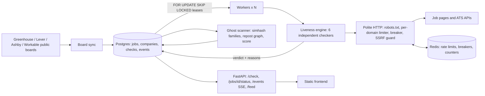

# Lively 🌻

**Job-listing liveness, freshness, and ghost/repost monitoring.**

Lively continuously monitors public job listings and answers a question that a plain availability check cannot: *is this job still genuinely open and actionable, or is it stale, closed, duplicated, or a ghost listing?*

---

## 1. What Lively does and who it helps

A job page returning HTTP 200 only proves that a server answered. It does not prove the role is still accepting applications. Lively combines several independent signals (HTTP behaviour, ATS data, company-board presence, page content, application controls and structured expiry metadata) into a verdict of `live`, `closed` or `uncertain`, with a confidence score and the reasons behind it.

It is built for job platforms, recruiting teams and job seekers who need to know whether a listing is still worth acting on.

- **Checks liveness.** Multiple signals are combined instead of trusting one page load.
- **Keeps data fresh.** Re-check frequency adapts to how stable or uncertain each listing is.
- **Explains decisions.** Every verdict stores the signals and plain-language reasons behind it.
- **Finds suspicious listings.** Similar jobs are grouped to spot evergreen, stale and repeatedly reposted roles.
- **Is observable.** Job counts, worker activity, queue state, checks and evaluation results are exposed through an API and dashboard.

The system has tracked about 12,000+ listings across 66 company boards. Counts depend on runtime, so read them from the dashboard.

---

## 2. Problem statement

A job matcher that promises "a few great jobs" cannot afford to send one that closed two weeks ago, was relisted under three IDs, or never had a real hire behind it. One dead job in an email costs more trust than ten good ones earn.

Three problems make this hard:

1. **A reachable page is not an open job.** Many closed jobs still return `200 OK` with "this position has been filled" in the body.
2. **Freshness does not scale naively.** Re-checking every job daily wastes requests on stable listings and still leaves fast-changing ones stale.
3. **Open does not mean real.** A listing can be live but evergreen, years old, or relisted again and again.

Lively treats liveness as an evidence-aggregation problem with an explicit `uncertain` state, and treats ghost/repost analysis as a separate heuristic assessment.

---

## 3. Demo and example checks

Runs locally via Docker Compose. Deployment is the next step, so there is no live URL yet.

Example job links to paste into the check box:

- https://job-boards.greenhouse.io/vercel/jobs/6188898004
- https://amazon.jobs/en/jobs/10612415/software-development-engineer-intern-2027-beijing
- https://www.micro1.ai/experts/opportunities


---

## 4. Architecture



The pipeline works as follows:

1. Discover and synchronise public company job boards.
2. Store job records and lifecycle state in PostgreSQL.
3. Workers claim due jobs through leases.
4. Pages and provider data are fetched through the shared polite HTTP client.
5. Independent liveness checkers run and their evidence is aggregated.
6. Check results and status transitions are persisted.
7. A separate scanner analyses similarity, reposts and ghost signals.
8. The API and dashboard expose operational and evaluation information.

PostgreSQL holds job state, check history, leases and schedules. Redis holds shared rate limits, circuit breakers, the robots cache and counters. Docker Compose runs the local stack.

---

## 5. Run locally

**Prerequisites:** Docker and Docker Compose, Git, a copy of the repository, and a `.env` file with the variables the Compose services expect.

Start the stack:

```bash
docker compose up -d --build --scale worker=3
```

The migration service runs first. The worker, API, metrics and ghost services start after it succeeds.

First-time bootstrap (opt-in, not run by `up`):

```bash
docker compose run --rm bootstrap
```

Bootstrap records completion in `app_state`. On later runs it does not repeat the initial seed, discover and sync unless forced. On a database that already has companies, it records that state instead of reseeding.

Run a ghost scan and open the dashboard:

```bash
docker compose exec collector python -m lively.ghost scan
open http://localhost:8000
```

Inspect the CLIs:

```bash
docker compose exec collector python -m lively.cli --help
docker compose exec collector python -m lively.ghost --help
```

Starting Compose keeps the services and workers running. The scheduler is application logic driven by persisted due times, and Docker is only the runtime.

---

## 6. How I built it: five stages

### Stage 1: Data collection and job lifecycle

- Pulls public job-board data from Greenhouse, Lever, Ashby and Workable, and discovers company boards by probing slug variants.
- Stores companies, jobs, check history, status events and labels in PostgreSQL.
- Tracks each job through `new → live → suspect → closed`, plus `reposted`.
- A job that vanishes from its board becomes `suspect`, not `closed`. Only the checkers can confirm a close.

The key choice was to persist each listing's history instead of treating every crawl as a disposable snapshot.


### Stage 2: Multi-signal liveness engine

Six independent checkers each emit a signal (`live`, `closed` or `uncertain`) with a base confidence $c_i$:

| Checker | Looks at | Weight $w_i$ |
|---|---|---|
| `ats_api` | ATS single-job endpoint | 0.95 |
| `http_status` | status code, redirects, login walls | 0.90 |
| `valid_through` | `validThrough` in JobPosting JSON-LD | 0.90 |
| `board_listing` | is the job still on the company board | 0.85 |
| `soft404` | "position filled" phrases, title on page | 0.80 |
| `apply_button` | apply link or form present | 0.50 |

Login walls, rate limits (429), 403, 5xx, timeouts and partial loads return `uncertain`, never a guess.

**Combining signals.** Each signal is scaled by its checker weight and capped, then turned into log-odds evidence, so strong signals count disproportionately more:

$$s_i = \min(0.97,\ c_i \cdot w_i) \qquad e_i = -\ln(1 - s_i)$$

Live evidence is added and closed evidence is subtracted, then squashed into a score:

$$N = \sum_{live} e_i - \sum_{closed} e_j \qquad P_{live} = \frac{1}{1 + e^{-N}} \qquad P_{closed} = 1 - P_{live}$$

**Verdict:** `closed` if $P_{closed} \ge 0.60$, else `live` if $P_{live} \ge 0.66$, else `uncertain`. A bare `200 OK` alone gives $P_{live} = 0.65$, so it stays `uncertain`, because a page that loads proves little. A job only moves to `closed` at confidence 0.75 or higher. Between 0.60 and 0.75 it becomes `suspect` and is re-checked sooner.

**Caveat:** the weights and thresholds are hand-set, not learned or calibrated, so these are heuristic scores, not literal probabilities. Signals are also treated as independent when they are not.

### Stage 3: Adaptive scheduling and worker reliability

Each job stores its next due time and check interval $I$. An unchanged job is checked half as often, and a changed one twice as often:

$$I_{next} = \begin{cases} \min(I_{max},\ 2I) & \text{if stable} \\ \max(I_{min},\ I/2) & \text{if changed} \end{cases}$$

- $I_{min}$ is 30 minutes and $I_{max}$ is 7 days. Delays get ±10% jitter so requests to one host don't synchronise.
- A change means the content hash changed, the verdict flipped, or the state moved.
- `suspect` jobs recheck every 2 to 24 hours, `uncertain` after 1 hour, and `closed` jobs weekly.
- Each company board is synced on its own schedule, and one board request marks every vanished job `suspect` at once.

**Savings** are projected from the current intervals:

$$\text{saved} = \Bigl(1 - \tfrac{\sum_j 86400 / I_j}{N}\Bigr) \times 100\%$$

This is negative right after a reset, while every job restarts at the base interval and only backs off as it stays stable. It reached 79.4% in an earlier steady-state run.

**Crash safety.** Workers claim jobs with `FOR UPDATE SKIP LOCKED` and a lease token that a heartbeat renews. If a worker dies, the lease expires and another worker reclaims the job. A late worker finds its token gone and discards its result. A unique index on `(job_id, lease_token)` allows only one recorded result per lease, so checking is at-least-once and recording is exactly-once.

### Stage 4: Ghost and repost analysis

Liveness asks whether a listing is open. Ghost analysis asks whether its history looks untrustworthy, and the two are kept separate.

- **Role families.** Within a company, listings group together if their fingerprints match, or if their title and location match and their 64-bit SimHash differs by at most 10 bits. SimHash is built from 3-word shingles and grouped with union-find.
- **Repost rule.** A listing is a repost if an earlier listing in its family ended, or was posted at least a day earlier.
- **Ghost score.** A capped sum of weighted signals, each with a plain-language reason:

$$\text{ghost\_score} = \min\Bigl(1,\ \sum_k p_k\Bigr)$$

| Signal | Typical points |
|---|---|
| Listing age (30 to 365+ days) | 0.08 to 0.65 |
| Reposts in the last 90 days | 0.18 to 0.50 |
| Earlier relistings, family first listed long ago | up to 0.20, plus 0.10 |
| Evergreen or talent-pool wording | 0.60 |
| Very short description, company relists many roles | 0.05 to 0.10 |

**Predicted label:** `closed` if the job is closed or suspect, `ghost` if the score is at least 0.60, `repost` if it is a repost, otherwise `live`. Because a 365-day-old listing scores 0.65 from age alone, the ghost label is currently driven largely by age.

### Stage 5: Evaluation, dashboard and operational hardening

- **Dashboard and API.** Tracked jobs, queue depth, checks per minute, closures caught, errors per domain, and re-checks saved versus a naive daily check.
- **Evaluation.** Predictions are compared with 100 hand-labelled jobs using per-class precision, recall and F1, plus a "bad-job filter" that treats closed and ghost together as the positive class.
- **Politeness.** A shared client applies to every request and redirect hop:
  - a Redis token bucket per domain (default 4 requests per second, burst 8)
  - jittered backoff, $\min(30, 2^a) + U(0,1)$ seconds
  - a per-host circuit breaker that opens after repeated failures and doubles its open time up to 10 minutes
  - robots.txt handling
  - an SSRF guard that rejects non-public addresses
- **Tests.** Automated tests cover state transitions, checkers, scheduling and worker reliability. A reliability-phase run passed 103 tests with zero skips. That is a historical result, not a guarantee about the current checkout.

---

## 7. Engineering design choices

1. **Evidence aggregation instead of a single HTTP check.** A successful response does not establish that applications are open. Independent signals reduce reliance on any one brittle indicator, and `uncertain` avoids forcing a verdict from incomplete evidence.
2. **Liveness separated from ghost detection.** Availability and hiring intent are different questions, and conflating them hides both.
3. **Adaptive scheduling.** Stable listings do not need the same frequency as uncertain or recently changed ones. Persisted intervals cut unnecessary work and allow faster follow-up when evidence changes.
4. **Leases and recoverable work.** A worker can crash at any point. Leases, heartbeats and stale-result protection keep work from getting stuck or double-recorded.
5. **Per-domain politeness and circuit breaking.** A crawler should not overload a company's ATS. Shared rate limits, backoff, jitter, robots handling and circuit breakers control request pressure and isolate failing hosts.
6. **SSRF protection at the request boundary.** URLs and redirects are external input, so destinations are validated before connection.
7. **Fingerprints rather than all-pairs comparison.** Shingles and SimHash make near-duplicate grouping practical as listings grow.

---

## 8. Evaluation metrics and what they mean

The labelled set contains **100 manually labelled jobs** across `live`, `closed`, `ghost` and `repost`. For each class $c$:

$$\text{Precision}_c = \frac{TP_c}{TP_c + FP_c} \qquad \text{Recall}_c = \frac{TP_c}{TP_c + FN_c}$$

$$F1_c = \frac{2 \cdot \text{Precision}_c \cdot \text{Recall}_c}{\text{Precision}_c + \text{Recall}_c} \qquad \text{Accuracy} = \frac{\sum_c TP_c}{\text{total labelled}}$$

$$\text{Macro-F1} = \frac{1}{\lvert C \rvert}\sum_{c} F1_c$$

**Bad-job filter.** What a user cares about is "was a dead or ghost job caught before reaching them". Treat `closed` and `ghost` together as the positive class, so a job predicted `ghost` that is really `closed` still counts as caught:

$$\text{Precision}_{bad} = \frac{TP}{TP + FP} \qquad \text{Recall}_{bad} = \frac{TP}{TP + FN}$$

### Results

| Class | Precision | Recall |
|---|---|---|
| Bad-job filter (closed or ghost) | 0.54 | 0.90 |
| closed | 1.00 | 1.00 |
| ghost | 0.00 | 0.00 |
| repost | 0.07 | 0.04 |

Closed detection scored perfectly on this sample. The bad-job filter catches most bad jobs (recall 0.90), but only about half of what it flags is truly bad (precision 0.54). Ghost versus repost is the weak point: most hand-labelled reposts were scored as ghosts, because age alone can push a listing over the 0.60 threshold.

### Evaluation caveats

- The 100-item set is small. A perfect score on a small class does not establish production accuracy.
- The sample is stratified, not random, so class proportions do not estimate population prevalence.
- Live and closed labels were cross-checked against ATS data, and the system also uses ATS signals, so closed-class results are optimistic.
- Ghost versus repost is a judgment call, and labels and scorer disagreed often.
- Scoring weights are hand-tuned, not learned or calibrated.

The accuracy page is a validation view, not a certified measure of real-world performance.

---

## 9. Known limitations

- **Limited ATS coverage.** Single-job API checks exist only for Greenhouse and Lever. Ashby and Workable rely on board presence and page signals.
- **Public boards only.** Private boards and many custom careers sites are not covered.
- **Heuristic confidence.** The liveness score is not a calibrated probability and treats correlated signals as independent, so it can be overconfident when several agree.
- **Ghost and repost validation.** Ghost scoring is hand-tuned and age-dominated. The labelled set is too small and ambiguous for reliable precision and recall.
- **Similarity is not intent.** Near-identical descriptions can be legitimate repeated hiring.
- **Per-company grouping.** The same role on different companies or boards is not merged.
- **Board sync cost.** Re-fetching whole boards becomes expensive as boards grow.
- **Language coverage.** Soft-404 detection is phrase-based and English-centric.
- **Operational dependencies.** Rate limiting and circuit breaking depend on Redis, and graceful degradation is not universal.
- **SSRF hardening is not immunity.** DNS rebinding and proxy edge cases need further defence in depth.
- **Duplicate work.** Concurrent scheduling and board sync can still cause duplicate checks. Leases and uniqueness controls reduce but do not eliminate every race.
- **Deployment.** This is a local demo stack, not a production service with a proven availability target.

---

## 10. Scaling Lively to 100K daily users

100K daily users is a different workload from tracking 100K jobs. User traffic, tracked listings and background check volume must be modelled separately.

**API and read path**
- Multiple stateless API instances behind a load balancer.
- Cache job status and dashboard aggregates, and add pagination and bounded limits to every list endpoint.
- Read replicas if PostgreSQL read traffic becomes the bottleneck, and CDN caching for static assets.

**Background processing**
- Separate worker pools for board sync, liveness checks and ghost analysis, scaled on queue depth and job age.
- Idempotent task handlers, retry budgets, dead-letter queues and backpressure.
- Prioritise uncertain and suspect jobs over stable ones.

**Database**
- Indexes for due jobs, company IDs, status and time-based history.
- Partition check and event history by time if size justifies it, and archive old check history while keeping state transitions.

**Provider protection**
- Per-domain request budgets enforced across all workers, with provider-specific limits and breakers.
- Slow down automatically when a provider is unhealthy.

**Observability**
- Centralised logs, traces and metrics, with alerts on queue age, expired leases, worker restarts, database saturation, Redis errors and provider failure rates.
- Realistic load tests before setting any service-level objective.

The first bottleneck is likely to be provider request limits, board synchronisation and background-check throughput, not the number of web users. Measure those independently before adding infrastructure.

---

## 11. What I would build with more time

1. **A stronger evaluation set.** A larger, independently labelled sample with written guidelines and multiple annotators for ambiguous cases.
2. **Confidence calibration.** Measure checker outcomes against reliable ground truth, then calibrate (for example with reliability diagrams and the Brier score) instead of presenting hand-tuned evidence as probability.
3. **Better ghost and repost modelling.** Separate repost detection from ghost-risk estimation, reduce the dominance of age, and train a model on the labels with the current score as one feature.
4. **Broader ATS support.** More provider integrations and better handling of custom careers sites.
5. **Cheaper board sync.** Incremental feeds, provider update timestamps or change detection instead of fetching whole boards.
6. **Reliability hardening.** Make Redis-dependent paths degrade safely, close remaining SSRF and DNS-rebinding gaps, and unify robots handling with host controls.
7. **Production validation.** Deploy with monitoring, run realistic load tests, and measure real traffic and checking costs before making scale or accuracy claims.
8. **Matcher integration.** Push the `job.closed` event stream into the matcher so closed jobs are pulled from queued emails before they send.

---

## Project principles

- A reachable URL is not proof of an open job.
- Uncertainty is a valid result.
- Liveness and ghost risk are different assessments.
- A confidence score is only as trustworthy as its evidence and evaluation.
- Background work must be recoverable, observable and polite to external providers.

Lively is an exploration of how to make job-listing freshness measurable. It does not claim that every stale or ghost listing can already be identified.


